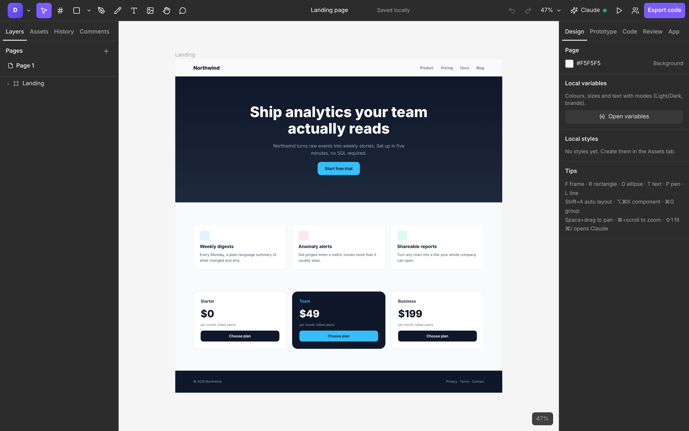
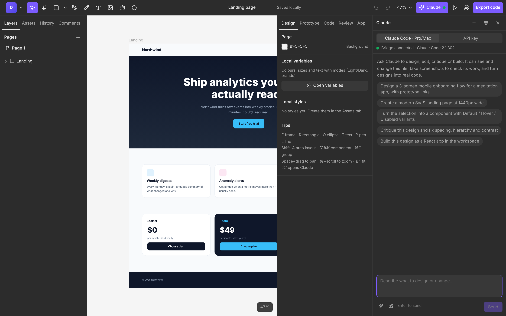
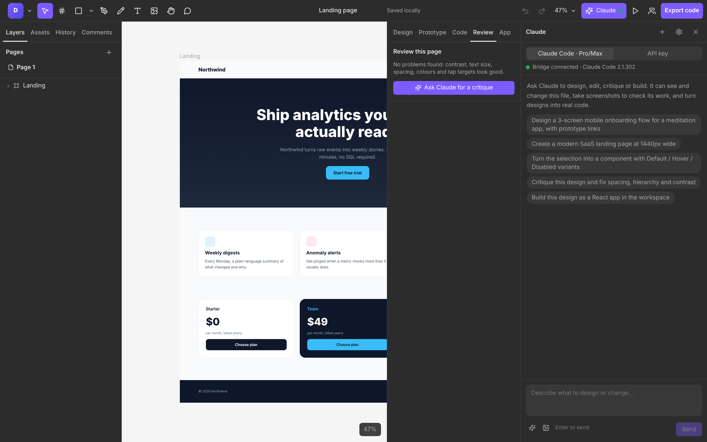
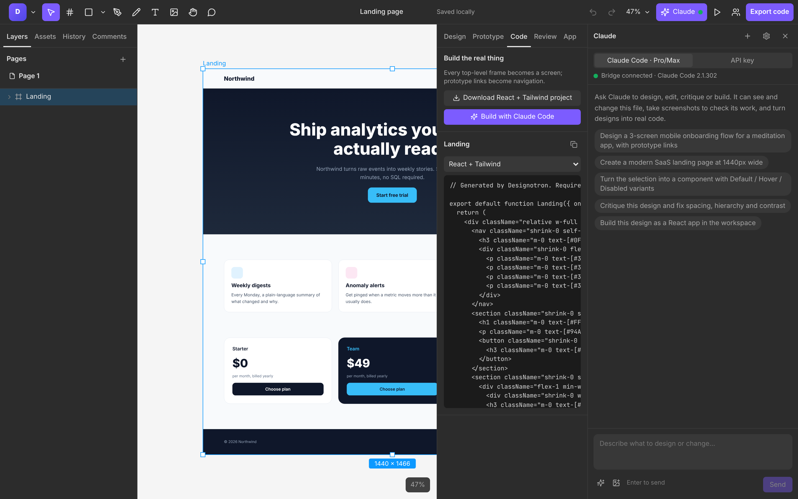

# Designotron

**The open-source design tool for people who build with Claude.** Design in a Figma-style
editor, let Claude design and critique beside you on your own Claude Pro/Max plan, and turn
the result into a working React app.


| | |
|---|---|
|  |  |
|  |  |

## What you get

- **A real design tool**: frames, pen and shapes, auto layout, constraints, components and
  variants, mixed text styles, boolean operations, masks, rulers, guides, layout grids,
  variables with light/dark modes, prototyping with a presenter, version history.
- **Claude, your way**: chat runs through your own **Claude Code** install (Pro/Max plan) or
  an API key. Claude edits the canvas live and checks its work with screenshots. Paste a
  screenshot or a URL and it rebuilds it as layers; quick actions build flows, variants,
  responsive and dark versions, and design tokens from your codebase.
- **Review**: contrast, tap targets, spacing and naming lint with one-click fixes, plus a
  Claude critique. Comments that Claude can read, act on and resolve.
- **Design to running code**: React + Tailwind or HTML export, a full Vite project where
  prototype links become navigation and variables become CSS variables, and a live preview
  of the app next to the canvas.
- **Bring your work**: import Figma files through the Figma API, import live websites, and
  use `.dtron` files that are plain JSON.
- **Together**: share a live session online (through a small relay server you can deploy in
  minutes) or on your local network, with cursors and selections; undo only ever reverts
  your own changes.
- **Extensible**: an MCP server for Claude Code in any terminal, and sandboxed JavaScript
  plugins on the same tool API Claude uses (Claude can write them too).
- **Fast and local-first**: Rust engine compiled to WebAssembly, incremental rendering for
  large files, files stay on your machine. MIT licensed.

See [STATUS.md](STATUS.md) for exactly what works and what doesn't, and
[ROADMAP.md](ROADMAP.md) for where it's going.

## Quick start

**Try it in your browser:** https://mikemich.github.io/designotron (no install; Claude needs the
local bridge or an API key).

**Run it on your computer** (editor + Claude Code bridge in one binary):

```bash
curl -fsSL https://raw.githubusercontent.com/mikemich/designotron/main/install.sh | sh
```

On macOS and Linux this also starts it in the background at every login
(`designotron service install`), so the hosted editor finds Claude without a terminal open.
The editor is also at http://127.0.0.1:5174, and Claude Code's files go in `~/Designotron`.
Skip the background service with `DESIGNOTRON_NO_SERVICE=1`, and run `~/.local/bin/designotron`
yourself (it then uses `./workspace`). Run the same command again to update.

On Windows, download the zip from [Releases](https://github.com/mikemich/designotron/releases/latest)
and run `designotron.exe`. (`npx designotron` will work once the npm package is published.)

**From source** (Node 20+ and Rust; the prebuilt WASM engine is committed):

```bash
git clone https://github.com/mikemich/designotron
cd designotron
./dev.sh
```

Open http://localhost:5173 and pick a template. Without the bridge the editor still works;
Claude Code chat, MCP, the live app preview, website import and sharing need it.

## Using Claude

### With your Claude Pro or Max plan (Claude Code)

1. Install [Claude Code](https://code.claude.com) and sign in once: run `claude`, then `/login`.
2. Run `./dev.sh`. The bridge finds your `claude` CLI.
3. In the editor, press `⌘/` (or click **Claude**), choose **Claude Code · Pro/Max** and ask
   for something like "Design a 3-screen onboarding flow with prototype links".

The bridge runs `claude -p` in the `workspace/` folder with the editor attached as an MCP
server, so usage counts against whatever Claude Code is signed in with. Designotron never
sees your credentials. File edits inside `workspace/` and a short list of commands
(`npm`, `npx`, `node`, `ls`, `mkdir`, `cat`) are pre-approved. Add more with
`DESIGNOTRON_ALLOWED_TOOLS`.

### From your own terminal (MCP)

With the bridge running, install the Claude Code plugin (MCP server plus a skill that
teaches Claude how to design well with it):

```
/plugin install designotron --marketplace mikemich/designotron
```

On older Claude Code: `/plugin marketplace add mikemich/designotron`, then
`/plugin install designotron@designotron`. Or add just the MCP server:

```bash
claude mcp add --transport http designotron http://127.0.0.1:5174/mcp
```

Claude Code now has `get_document`, `create_nodes`, `update_nodes`, `get_screenshot`,
`export_code` and the rest. Changes appear live in the open editor. With no editor open, the
tools edit `workspace/design.dtron.json` directly.

### With an API key

In the Claude panel choose **API key**, open settings and paste a key. Requests go straight
from your browser to the Anthropic API using the official SDK. The default model is Claude
Opus 5.5 with adaptive thinking, and server-side refusal fallback is enabled. The key is
stored in this browser's localStorage.

## Working together

**Share** (toolbar) offers two ways to edit a file live with other people:

- **Online**: anyone with the link, anywhere. Rooms live on a Designotron relay, a small
  open-source server that also serves the editor. Deploy one on Fly.io, Render or any
  Docker host in a few minutes: see [docs/relay.md](docs/relay.md).
- **Local network**: same Wi-Fi, no server; your bridge hosts the session behind a secret
  link.

## Design to code

- **Code tab**: React + Tailwind, HTML/CSS, CSS or SVG for the selected layer.
- **Export code** (toolbar): a zip with a Vite + React + Tailwind project. Each top-level
  frame becomes a screen, components become React components, and prototype links become
  navigation.
- **Build with Claude Code** (Code tab): asks Claude Code to turn the design into a
  production-quality app in `workspace/`, run the build, and report back.

## Production build and releases

```bash
cd web && npm run build                                   # outputs web/dist
cd .. && cargo build --release -p designotron-bridge --features embed-web
./target/release/designotron                              # one binary, editor included
```

Everything after the one-time setup below runs from GitHub Actions:

| What                    | How                                                                 |
|-------------------------|---------------------------------------------------------------------|
| Hosted editor           | Every push to `main` (`pages.yml`)                                  |
| Release binaries        | Push a `v*` tag, or Actions → Release → Run workflow with a version (`release.yml`). The version comes from the tag |
| Online relay            | Every push to `main` redeploys it: Render through `RENDER_DEPLOY_HOOK`, or Fly (`relay-deploy.yml`); the hosted editor uses it for Share → Online |
| Relay Docker image      | Every push to `main` (`relay-image.yml`, `ghcr.io/mikemich/designotron-relay`) |

One-time setup (Settings → Secrets and variables → Actions):

1. Pages: Settings → Pages → Source: **GitHub Actions**.
2. Relay for online multiplayer, either:
   - free: the **Deploy to Render** button in [docs/relay.md](docs/relay.md), then set the
     variable `DT_RELAY_URL` to its URL (it sleeps when idle and wakes on the next share), or
   - always on (a few dollars a month): secret `FLY_API_TOKEN` and variable `FLY_APP`, then
     run Actions → **Deploy relay** once; it creates the app and rebuilds the hosted editor.
3. npm (optional): `cd npm && npm publish` after each release, so `npx designotron` works.

`install.sh` and the `npx designotron` launcher download the binaries from the latest release.

## Keyboard shortcuts

| Action                 | Shortcut          | Action               | Shortcut        |
|------------------------|-------------------|----------------------|-----------------|
| Move                   | V                 | Group / ungroup      | ⌘G / ⇧⌘G        |
| Frame                  | F or A            | Frame selection      | ⌥⌘G             |
| Rectangle / ellipse    | R / O             | Auto layout          | ⇧A              |
| Line / arrow           | L / ⇧L            | Create component     | ⌥⌘K             |
| Pen / pencil           | P / ⇧P            | Detach instance      | ⌥⌘B             |
| Text                   | T                 | Duplicate            | ⌘D              |
| Hand (or hold Space)   | H                 | Bring forward / back | ⌘] / ⌘[         |
| Zoom to fit / select   | ⇧1 / ⇧2           | Align left/right/…   | ⌥A ⌥D ⌥W ⌥S     |
| Zoom 100%              | ⇧0                | Flip H / V           | ⇧H / ⇧V         |
| Undo / redo            | ⌘Z / ⇧⌘Z          | Hide / lock          | ⇧⌘H / ⇧⌘L       |
| Claude panel           | ⌘/                | Save `.dtron`        | ⌘S              |
| Comment                | C                 | Rulers / grids       | ⇧R / ⇧⌘4        |
| Flatten / outline      | ⌘E / ⇧⌘O          | Use as mask          | ⌥⌘M             |

## Architecture

```
┌──────────── browser ────────────┐        ┌────── bridge (Rust, 127.0.0.1:5174) ──────┐
│ React shell  ⇄  engine (WASM)   │◀─ ws ─▶│ editor relay · MCP server · headless engine│
│ canvas · panels · chat          │        │ spawns `claude -p` (Pro/Max or API key)    │
└─────────────────────────────────┘        └──────────────▲─────────────────────────────┘
                                                          │ MCP (HTTP)
                                                   Claude Code in any terminal
```

- `crates/engine`: document model, commands and undo, layout, components, rendering, code
  generation and the AI tool layer
- `crates/engine-wasm`: WebAssembly bindings
- `crates/bridge`: the local server
- `crates/rooms`: multiplayer rooms (shared by the bridge and the relay)
- `crates/relay`: the internet relay for online multiplayer
- `web`: the editor UI

Contributing: read [CONTRIBUTING.md](CONTRIBUTING.md). Coding agents: read [AGENTS.md](AGENTS.md).

## File format

`.dtron` files are JSON: `{ "format": "designotron", "version": 1, "document": {...}, "assets": {...} }`.
The document schema is defined in `crates/engine/src/model.rs`.

## License

MIT
